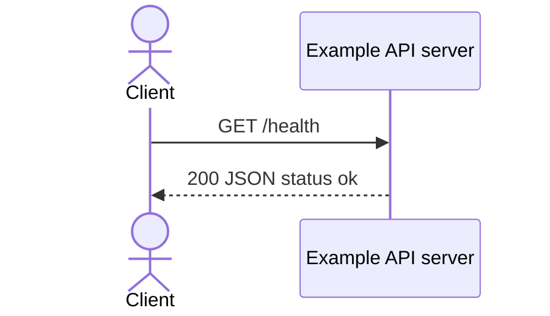

# Check API health

## Overview

Return a static response showing that the local example server can handle this
request. This is a liveness-style example, not a dependency readiness check.

## Contract

| Property              | Value                                  |
| --------------------- | -------------------------------------- |
| Method                | GET                                    |
| Route                 | `/health`                              |
| Local base URL        | `http://127.0.0.1:3100` (default port) |
| Request body          | Not required or read by the handler    |
| Response content type | `application/json`                     |
| API version           | No version negotiation implemented     |

## Authentication and authorization

No authentication or authorization is implemented in this loopback-only example
server. No production gateway or deployment policy is supplied.

## Request

No path parameters, application-specific headers, or body fields are required.
Query parameters are ignored. Only the exact pathname `/health` matches;
`/health/` falls through to the server's 404 response.

## Responses

| Status | Condition                     | Body                 |
| ------ | ----------------------------- | -------------------- |
| 200    | GET request matches `/health` | `{ "status": "ok" }` |

| Field  | Type   | Required / nullable                 | Meaning                  |
| ------ | ------ | ----------------------------------- | ------------------------ |
| status | string | Present, non-null; fixed value `ok` | Static success indicator |

`Content-Type` is `application/json`. Pagination is not applicable.

## Errors

| Status | Machine code | Message     | Trigger                                  | Caller action           |
| ------ | ------------ | ----------- | ---------------------------------------- | ----------------------- |
| 404    | Not provided | `Not found` | Unsupported method or unmatched pathname | Correct the method/path |

The matched health handler has no application-specific failure branch. A 200
response does not establish that any external dependency is healthy.

## Behavior

Return the static JSON body and end the response. No state is read or changed;
there are no dependency calls or events. Repeated matched requests return the
same body. The server does not implement readiness checks.

## Relationships

No upstream application caller is defined. Inspection of `server.mjs` found no
downstream dependency for this endpoint; no database or service checks occur.

## Request flow



## Examples

After starting `node server.mjs` from the example directory:

```sh
curl -i http://127.0.0.1:3100/health
```

Expected status: 200. Body:

```json
{ "status": "ok" }
```

An unsupported method uses the fallback response:

```sh
curl -i -X POST http://127.0.0.1:3100/health
```

Expected status: 404. Body:

```json
{ "error": "Not found" }
```

## Limits and operations

The handler configures no application rate limit, payload limit, explicit timeout,
or performance target. Runtime defaults are not specified here. The server uses
loopback address `127.0.0.1`; `PORT` overrides the default 3100. Examples assume
the default port and contain no credentials.

## Evidence and verification

- `server.mjs`: the `createServer` callback, GET `/health` branch, shared content
  type, fallback response, and listening configuration.
- CLI structural/reference checks do not establish endpoint semantics; the CLI's
  semantic check remains `skipped`.
- Success and unsupported-method examples were exercised against the local server
  during development. Production deployment behavior was not tested.
- Mermaid syntax is source-reviewed; rendering has not been tested.
