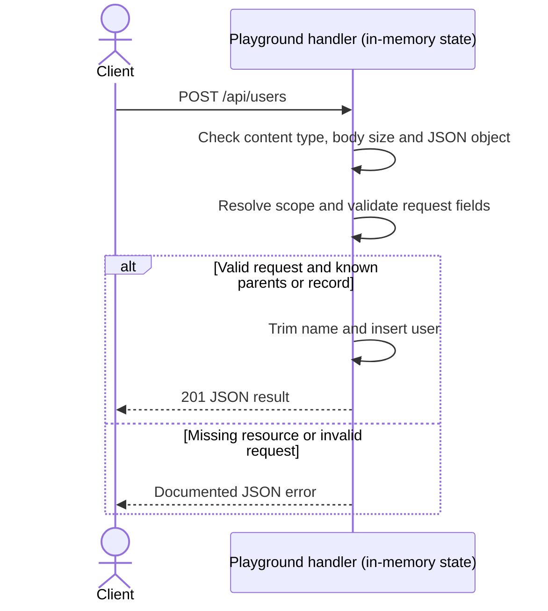

# Create an example user

## Overview

Validate name, trim surrounding whitespace, assign the next user ID, and insert the user.

## Contract

| Property            | Value                                  |
| ------------------- | -------------------------------------- |
| Method and route    | `POST /api/users`                      |
| Local base URL      | `http://127.0.0.1:3100` (default port) |
| Request media type  | `application/json`                     |
| Response media type | `application/json`                     |
| Version             | No API version negotiation             |

## Authentication and authorization

No authentication or authorization middleware is implemented. Parent IDs scope
lookup; they are not a substitute for permission checks in a real application.
The server is loopback-only and includes no production gateway.

## Request

| Field | Location | Type   | Required / nullable | Constraints / default           | Meaning           |
| ----- | -------- | ------ | ------------------- | ------------------------------- | ----------------- |
| name  | Body     | string | Required, non-null  | Nonempty after trim; no default | User display name |

Query parameters are ignored. Paths match exactly; trailing slashes and extra
segments do not match. Path segments are compared without explicit percent-decoding.

Send `Content-Type: application/json` (an optional charset parameter is accepted).
The body must be a JSON object, at most 16 KiB. Unknown fields, null values, wrong
types, and whitespace-only string fields are rejected; strings are trimmed.

### JSON request example

```json
{
  "name": "Grace"
}
```

These are synthetic sample values. They are not server defaults. The field table
identifies any actual default and what happens when optional fields are omitted.

## Responses

| Status | Condition                                                    | Body              |
| ------ | ------------------------------------------------------------ | ----------------- |
| 201    | Matched request with valid fields and existing parent/record | JSON result below |
| 400    | Malformed JSON, non-object body, or invalid/unknown fields   | JSON error object |
| 413    | Body exceeds 16 KiB                                          | JSON error object |
| 415    | Unsupported/missing JSON content type                        | JSON error object |

| Field | Type   | Required / nullable | Meaning             |
| ----- | ------ | ------------------- | ------------------- |
| id    | string | Present, non-null   | Resource identifier |
| name  | string | Present, non-null   | Display name        |

JSON responses use `Content-Type: application/json`.

## Errors

| Status | Message                                    | Trigger                                                       | Caller action                     |
| ------ | ------------------------------------------ | ------------------------------------------------------------- | --------------------------------- |
| 400    | Invalid JSON / JSON body must be an object | JSON cannot be parsed or the top-level value is not an object | Send a valid object               |
| 400    | Unknown field                              | Unrecognized body field                                       | Send only allowed fields          |
| 400    | name is required                           | Required field omitted                                        | Supply name                       |
| 400    | name must be a nonempty string             | Wrong field type or invalid string                            | Correct name                      |
| 413    | Request body exceeds 16 KiB                | JSON payload limit exceeded                                   | Send a smaller body               |
| 415    | Content-Type must be application/json      | Missing/unsupported content type                              | Use application/json              |
| 404    | Not found                                  | Unmatched method/path                                         | Correct the route and HTTP method |

Errors have the shape `{ "error": "message" }`; no separate machine code is
provided. Unsupported method/path combinations use fallback 404, not 405.

## Behavior

Validate name, trim surrounding whitespace, assign the next user ID, and insert the user.

IDs are incrementing strings starting at 2; deleting a user does not reuse its ID.

Content type, size and JSON-object parsing happen before the route handler.
The handler resolves existing parents/records before field validation when those
lookups are needed. Invalid input does not mutate state.

Repeating a successful POST creates another record. No idempotency key, retry
policy, external side effect, or event publication is implemented.

## Relationships

No database, external service, event bus, or upstream application caller is
defined by this standalone playground. All storage is local to this server process.

The endpoint uses the shared in-process users Map.

## Request flow



## Examples

Start `node examples/node-api/server.mjs` from the repository root. These
examples assume fresh seeded state and the default port; earlier mutations can
change the result.

```sh
curl -i -X POST http://127.0.0.1:3100/api/users \
  -H 'Content-Type: application/json' \
  --data '{"name":"Grace"}'
```

Expected status: 201.

```json
{
  "id": "2",
  "name": "Grace"
}
```

Invalid body example:

```sh
curl -i -X POST http://127.0.0.1:3100/api/users \
  -H 'Content-Type: application/json' \
  --data '{}'
```

Expected status: 400.

```json
{
  "error": "name is required"
}
```

## Limits and operations

The server binds to `127.0.0.1`; `PORT` overrides the default 3100. Data resets
when the process restarts. There is no persistence, authentication middleware,
rate limit, application timeout, or performance guarantee. Runtime HTTP defaults
are not specified here. This is a local test fixture, not a production service.

JSON write bodies are limited to 16 KiB.

## Evidence and verification

- `server.mjs`: `createExampleServer`, the `POST` registration for `/api/users`,
  its handler, scoped lookup helpers, `send`, and `readJson` / `fields` for JSON writes.
- `server.test.mjs`: local HTTP integration checks exercise user CRUD, nested task
  CRUD/comments, missing parents, validation, content type, body size, and health.
- These checks cover this playground locally; no deployment behavior is claimed.
- CLI structural/reference checks are separate; CLI semantic checks remain `skipped`.
- The success/error HTTP examples were exercised against fresh local servers.
- The sequence diagram rendered successfully in the local reader during development.
