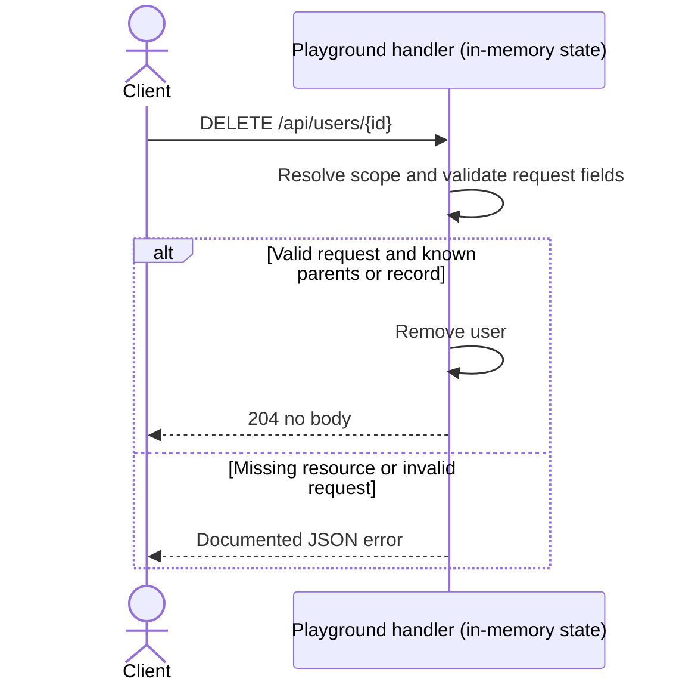

# Delete an example user

## Overview

Find the user and remove it from the users Map.

## Contract

| Property            | Value                                  |
| ------------------- | -------------------------------------- |
| Method and route    | `DELETE /api/users/{id}`               |
| Local base URL      | `http://127.0.0.1:3100` (default port) |
| Request media type  | No request body                        |
| Response media type | No body on success; JSON for errors    |
| Version             | No API version negotiation             |

## Authentication and authorization

No authentication or authorization middleware is implemented. Parent IDs scope
lookup; they are not a substitute for permission checks in a real application.
The server is loopback-only and includes no production gateway.

## Request

| Field | Location | Type   | Required / nullable | Constraints / default            | Meaning |
| ----- | -------- | ------ | ------------------- | -------------------------------- | ------- |
| id    | Path     | string | Required, non-null  | One nonempty segment; no default | User ID |

Query parameters are ignored. Paths match exactly; trailing slashes and extra
segments do not match. Path segments are compared without explicit percent-decoding.

No request body. The handler does not parse a body or require a content type.

## Responses

| Status | Condition                                                    | Body              |
| ------ | ------------------------------------------------------------ | ----------------- |
| 204    | Matched request with valid fields and existing parent/record | No body           |
| 404    | User not found                                               | JSON error object |

A 204 response contains no body and no Content-Type header.

## Errors

| Status | Message        | Trigger                          | Caller action                               |
| ------ | -------------- | -------------------------------- | ------------------------------------------- |
| 404    | User not found | Selected parent/record is absent | Use IDs from the matching parent collection |
| 404    | Not found      | Unmatched method/path            | Correct the route and HTTP method           |

Errors have the shape `{ "error": "message" }`; no separate machine code is
provided. Unsupported method/path combinations use fallback 404, not 405.

## Behavior

Find the user and remove it from the users Map.

The response has no body. Deleting an already absent user returns 404.

## Relationships

No database, external service, event bus, or upstream application caller is
defined by this standalone playground. All storage is local to this server process.

The endpoint uses the shared in-process users Map.

## Request flow



## Examples

Start `node examples/node-api/server.mjs` from the repository root. These
examples assume fresh seeded state and the default port; earlier mutations can
change the result.

```sh
curl -i -X DELETE http://127.0.0.1:3100/api/users/1
```

Expected status: 204.

The response body is empty.

Missing-resource example:

```sh
curl -i -X DELETE http://127.0.0.1:3100/api/users/missing
```

Expected status: 404.

```json
{
  "error": "User not found"
}
```

## Limits and operations

The server binds to `127.0.0.1`; `PORT` overrides the default 3100. Data resets
when the process restarts. There is no persistence, authentication middleware,
rate limit, application timeout, or performance guarantee. Runtime HTTP defaults
are not specified here. This is a local test fixture, not a production service.

## Evidence and verification

- `server.mjs`: `createExampleServer`, the `DELETE` registration for `/api/users/{id}`,
  its handler, scoped lookup helpers, `send`, and the in-memory seed.
- `server.test.mjs`: local HTTP integration checks exercise user CRUD, nested task
  CRUD/comments, missing parents, validation, content type, body size, and health.
- These checks cover this playground locally; no deployment behavior is claimed.
- CLI structural/reference checks are separate; CLI semantic checks remain `skipped`.
- The success/error HTTP examples were exercised against fresh local servers.
- The sequence diagram rendered successfully in the local reader during development.
