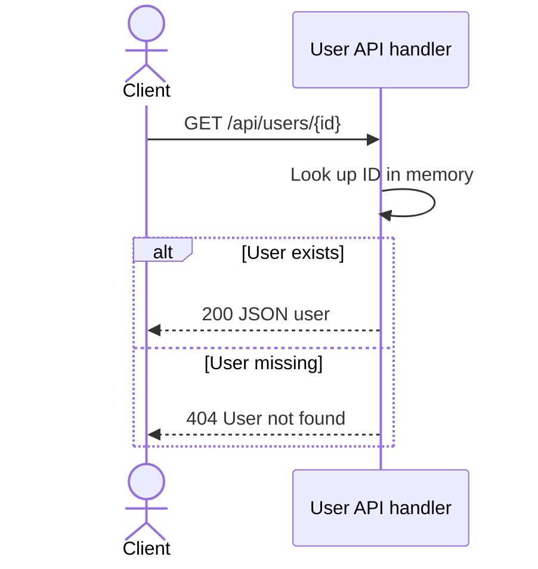

# Get an example user by ID

## Overview

Retrieve a user from the playground's fixed, in-memory dataset. This example
contains only `{ "id": "1", "name": "Ada" }`; it does not query a database.

## Contract

| Property              | Value                                                |
| --------------------- | ---------------------------------------------------- |
| Method                | GET                                                  |
| Route                 | `/api/users/{id}`                                    |
| Local base URL        | `http://127.0.0.1:3100` (default port)               |
| Request body          | Not required; the handler does not read it           |
| Response content type | `application/json`                                   |
| API version           | No version prefix or version negotiation implemented |

## Authentication and authorization

The example server has no authentication or authorization middleware. It binds to
`127.0.0.1` and is intended for local testing. No production gateway is included.

## Request

| Field | Location | Type   | Required / nullable | Constraints / default                                       | Meaning                                  |
| ----- | -------- | ------ | ------------------- | ----------------------------------------------------------- | ---------------------------------------- |
| id    | Path     | string | Required; nonempty  | One nonempty path segment; no numeric validation or default | Compared exactly with the stored user ID |

No application-specific request headers are required. Query parameters are ignored.
The handler uses the URL pathname without an explicit decode step for the ID.
A trailing slash or extra segment does not match this route.

## Responses

| Status | Condition                               | Body                            |
| ------ | --------------------------------------- | ------------------------------- |
| 200    | Stored ID matches the requested segment | JSON user object                |
| 404    | Route matches but the ID is unknown     | `{ "error": "User not found" }` |

Successful response fields:

| Field | Type   | Required / nullable                    | Meaning         |
| ----- | ------ | -------------------------------------- | --------------- |
| id    | string | Present, non-null in the fixed dataset | User identifier |
| name  | string | Present, non-null in the fixed dataset | Display name    |

The handler sets `Content-Type: application/json` for all responses. Pagination
is not applicable because this endpoint returns at most one user.

## Errors

| Status | Machine code | Message          | Trigger                                              | Caller action                                                        |
| ------ | ------------ | ---------------- | ---------------------------------------------------- | -------------------------------------------------------------------- |
| 404    | Not provided | `User not found` | A matched ID is not in the dataset                   | Use an existing ID; retrying the same request does not create a user |
| 404    | Not provided | `Not found`      | Route shape does not match, or the method is not GET | Correct the method/path                                              |

The server uses a fallback 404 for unsupported methods, not 405. It does not
implement additional application error envelopes or a retry policy.

## Behavior

1. Match a GET request with exactly one segment after `/api/users/`.
2. Find the first user whose stored ID equals the requested segment.
3. Return the user with 200, or the missing-user error with 404.

This is a read-only lookup with no state mutation, event publication, or external
calls. Repeated requests against the same process dataset return the same result.

## Relationships

| Target                 | Interaction      | Trigger / condition | Failure behavior                       |
| ---------------------- | ---------------- | ------------------- | -------------------------------------- |
| In-process users array | Read-only lookup | Matched GET request | Missing ID produces the documented 404 |

No upstream application callers are defined in this standalone example. Inspection
of `server.mjs` found no downstream service, database, or event infrastructure.

## Request flow



The diagram covers the matched endpoint. Requests that fail method/path matching
receive the server's fallback 404 before the lookup.

## Examples

Start the local server with `node server.mjs` from this example directory.
These examples use the default port; use the configured port if `PORT` is set.

Successful lookup:

```sh
curl -i http://127.0.0.1:3100/api/users/1
```

Expected status: 200. Body:

```json
{ "id": "1", "name": "Ada" }
```

Unknown user:

```sh
curl -i http://127.0.0.1:3100/api/users/unknown
```

Expected status: 404. Body:

```json
{ "error": "User not found" }
```

## Limits and operations

The handler defines no application rate limit, request-body limit, explicit
timeout, or performance guarantee. Runtime HTTP defaults are not specified here.
The dataset is fixed in source and is not persisted externally. `PORT` selects
the listening port; its default is 3100. The server listens only on loopback.

## Evidence and verification

- `server.mjs`: `users`, the `createServer` callback, GET route matcher, lookup,
  fallback response, and `server.listen` configuration.
- CLI structural/reference validation is separate from source review; semantic
  checks remain `skipped`.
- The success and missing-user examples were exercised against the local server
  during development. Deployment behavior outside this example was not tested.
- Mermaid syntax is source-reviewed; rendering has not been tested.
