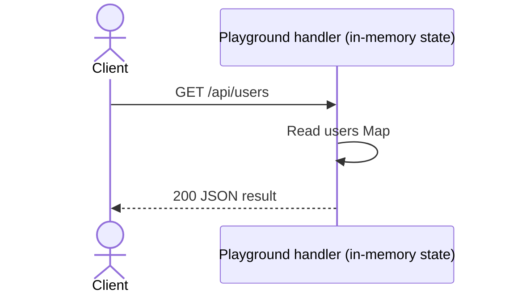

# List example users

## Overview

Read all users from the in-process users Map.

## Contract

| Property            | Value                                  |
| ------------------- | -------------------------------------- |
| Method and route    | `GET /api/users`                       |
| Local base URL      | `http://127.0.0.1:3100` (default port) |
| Request media type  | No request body                        |
| Response media type | `application/json`                     |
| Version             | No API version negotiation             |

## Authentication and authorization

No authentication or authorization middleware is implemented. Parent IDs scope
lookup; they are not a substitute for permission checks in a real application.
The server is loopback-only and includes no production gateway.

## Request

No path parameters or body fields are required.

Query parameters are ignored. Paths match exactly; trailing slashes and extra
segments do not match. Path segments are compared without explicit percent-decoding.

No request body. The handler does not parse a body or require a content type.

## Responses

| Status | Condition       | Body              |
| ------ | --------------- | ----------------- |
| 200    | Matched request | JSON result below |

| Field        | Type   | Required / nullable | Meaning                             |
| ------------ | ------ | ------------------- | ----------------------------------- |
| items        | array  | Present, non-null   | Collection of results; may be empty |
| items[].id   | string | Present, non-null   | Resource identifier                 |
| items[].name | string | Present, non-null   | Display name                        |

JSON responses use `Content-Type: application/json`.

## Errors

| Status | Message   | Trigger               | Caller action                     |
| ------ | --------- | --------------------- | --------------------------------- |
| 404    | Not found | Unmatched method/path | Correct the route and HTTP method |

Errors have the shape `{ "error": "message" }`; no separate machine code is
provided. Unsupported method/path combinations use fallback 404, not 405.

## Behavior

Read all users from the in-process users Map.

Results follow Map insertion order. There is no filtering or pagination.
This operation does not mutate state. Results can change when other CRUD requests
modify the same server process.

## Relationships

No database, external service, event bus, or upstream application caller is
defined by this standalone playground. All storage is local to this server process.

The endpoint uses the shared in-process users Map.

## Request flow



## Examples

Start `node examples/node-api/server.mjs` from the repository root. These
examples assume fresh seeded state and the default port; earlier mutations can
change the result.

```sh
curl -i http://127.0.0.1:3100/api/users
```

Expected status: 200.

```json
{
  "items": [
    {
      "id": "1",
      "name": "Ada"
    }
  ]
}
```

## Limits and operations

The server binds to `127.0.0.1`; `PORT` overrides the default 3100. Data resets
when the process restarts. There is no persistence, authentication middleware,
rate limit, application timeout, or performance guarantee. Runtime HTTP defaults
are not specified here. This is a local test fixture, not a production service.

## Evidence and verification

- `server.mjs`: `createExampleServer`, the `GET` registration for `/api/users`,
  its handler, scoped lookup helpers, `send`, and the in-memory seed.
- `server.test.mjs`: local HTTP integration checks exercise user CRUD, nested task
  CRUD/comments, missing parents, validation, content type, body size, and health.
- These checks cover this playground locally; no deployment behavior is claimed.
- CLI structural/reference checks are separate; CLI semantic checks remain `skipped`.
- The success/error HTTP examples were exercised against fresh local servers.
- The sequence diagram rendered successfully in the local reader during development.
