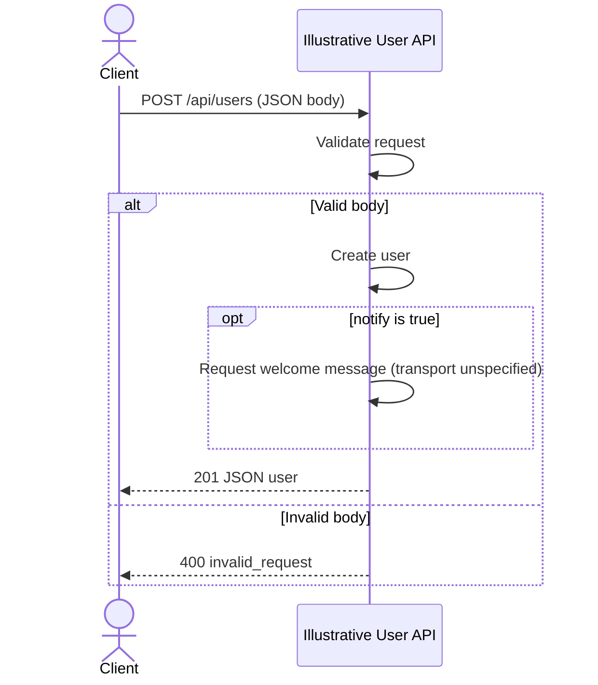

# Create a user — illustrative example

## Overview

This fictional API demonstrates the document layout and a JSON request body. It
is not a discovered endpoint, source-backed specification, or tested
implementation in your project.

## Contract

| Property            | Value                                       |
| ------------------- | ------------------------------------------- |
| Method and route    | `POST /api/users`                           |
| Request media type  | `application/json`                          |
| Response media type | `application/json`                          |
| Version             | Not specified in this illustrative contract |

## Authentication and authorization

This illustrative contract requires no credentials. That is an example design
choice, not a claim about your application's authentication or gateway.

## Request

| Field  | Location | Type    | Required / nullable | Constraints / default            | Meaning                |
| ------ | -------- | ------- | ------------------- | -------------------------------- | ---------------------- |
| name   | Body     | string  | Required, non-null  | Nonempty; no default             | Display name           |
| email  | Body     | string  | Required, non-null  | Email address; no default        | Contact address        |
| notify | Body     | boolean | Optional, non-null  | Defaults to `false` when omitted | Send a welcome message |

No path or query parameters are defined in this example. Send the body with
`Content-Type: application/json`.

### JSON request example

```json
{
  "name": "Ada",
  "email": "ada@example.invalid",
  "notify": false
}
```

`Ada` and `ada@example.invalid` are synthetic sample values, not server defaults.
In this fictional contract, omitting `notify` uses `false`; sending `null` is
invalid. A real spec must establish defaults and omission behavior from source.

## Responses

| Status | Condition            | Body         |
| ------ | -------------------- | ------------ |
| 201    | Valid user data      | User object  |
| 400    | Invalid request body | Error object |

| Field | Type   | Required / nullable | Meaning         |
| ----- | ------ | ------------------- | --------------- |
| id    | string | Present, non-null   | User ID         |
| name  | string | Present, non-null   | Display name    |
| email | string | Present, non-null   | Contact address |

## Errors

| Status | Code / message    | Trigger                | Caller action            |
| ------ | ----------------- | ---------------------- | ------------------------ |
| 400    | `invalid_request` | Body fails field rules | Correct the request body |

The illustrative error body is `{ "error": "invalid_request" }`.

## Behavior

Validate the body and create a user. When `notify` is `true`, request a welcome
message; this simplified example does not define its transport or delivery
policy. No idempotency or retry guarantee is defined. A real spec must replace
these fictional rules with evidence from the selected implementation.

## Relationships

Persistence and notification dependencies are not specified in this illustrative
contract. Do not infer that a real user-creation endpoint has no database or
service dependencies.

## Request flow



## Examples

Illustrative request using the JSON above; `api.example.invalid` is not a live
test endpoint:

```sh
curl -X POST https://api.example.invalid/api/users \
  -H 'Content-Type: application/json' \
  --data '{"name":"Ada","email":"ada@example.invalid","notify":false}'
```

Illustrative 201 response:

```json
{ "id": "1", "name": "Ada", "email": "ada@example.invalid" }
```

Illustrative invalid request (missing required `name`):

```sh
curl -X POST https://api.example.invalid/api/users \
  -H 'Content-Type: application/json' \
  --data '{"email":"ada@example.invalid"}'
```

Illustrative 400 response:

```json
{ "error": "invalid_request" }
```

## Limits and operations

Rate limits, timeouts, deployment settings, and performance guarantees are not
defined by this example. A real document must record evidence or explicit gaps.

## Evidence and verification

No source evidence is claimed. These examples have not been sent to a server.
The diagram is illustrative and not render-tested. Frontmatter can be checked
independently; it does not establish that the fictional endpoint exists.
