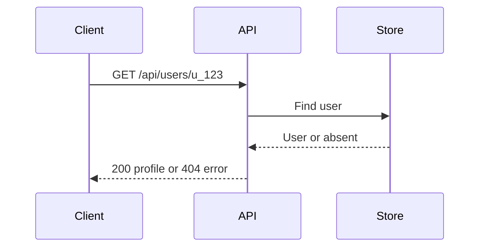

# @speckub/schema

**Your code. Your specs. Every branch.**

SpecKub helps your coding agent turn existing HTTP APIs into Markdown documentation
that lives beside your code. Specs describe contracts, errors, examples, service
relationships, and request flows. They can be reviewed in Git and read in a local
website.

This package provides the **document format and parser**. For the complete workflow,
start with [@speckub/cli](https://www.npmjs.com/package/@speckub/cli); it includes
schema and core automatically.

## From an existing API to readable documentation

**User story:** “Our API already works, but new teammates keep asking how to call
it. I want source-backed docs, examples, and a reader without maintaining a
separate documentation service.”

1. **Initialize in your terminal** (Node.js 22+):

   ```sh
   npm install --save-dev @speckub/cli@0.1.3
   npx speckub init --agent codex
   ```

2. **Open your coding agent in that project.** Run each instruction in agent chat,
   reviewing the output before the next step:

   ```text
   $speckub-scan Discover this project's HTTP APIs and report uncertain routes.
   $speckub-relations Map API callers and downstream services from source.
   $speckub-create Create API docs with examples, errors, and sequence diagrams.
   ```

   Use `--agent claude` or `--agent cursor` at initialization for those agents,
   then `/speckub.scan`, `/speckub.relations`, and `/speckub.create` in their chat.

3. **Read the result in your terminal/browser:**

   ```sh
   npx speckub list
   npx speckub ui --serve
   ```

   Open the printed URL. Review the Markdown and commit it through your normal
   pull request. The agent creates docs; `init` installs the workflow and `ui`
   renders existing docs. The CLI does not run a model.

For custom layouts, use `$speckub-template` before creation, or edit
`.speckub/templates/api.md`. Keep the contract metadata while changing headings,
tables, and examples. See the
[complete walkthrough](https://www.npmjs.com/package/@speckub/cli#user-story-document-an-existing-api).

## When to use this package directly

| Use case                                            | Schema API                                                    |
| --------------------------------------------------- | ------------------------------------------------------------- |
| Build a Markdown editor that checks API metadata    | `parseEndpointMarkdown` returns field-specific issues         |
| Identify endpoint documents among ordinary Markdown | `discoverEndpointMarkdown` classifies marked and legacy specs |
| Validate metadata supplied as an object             | `endpointSchema.safeParse` checks the HTTP contract           |
| Reuse endpoint types in TypeScript tools            | `EndpointSpec` and `EndpointIdentity` describe validated data |

For filesystem discovery, duplicate IDs, and source-file checks, use
[@speckub/core](https://www.npmjs.com/package/@speckub/core). Schema alone has no
executable or source-code scanner.

## A SpecKub document

This is an illustrative contract; replace its route and source with your actual
implementation. Real docs can have any Markdown section layout.

````md
---
speckub: true
specVersion: 1
id: users.get-by-id
kind: http
method: GET
path: /api/users/{id}
summary: Get a user by ID
tags:
  - users
source:
  - src/controllers/UserController.java
---

# Get a user by ID

Returns a public user profile for the requested identifier.

## Request

| Field | Location | Type   | Required |
| ----- | -------- | ------ | -------- |
| id    | Path     | String | Yes      |

## Responses

| Status | Body                                        | Meaning          |
| ------ | ------------------------------------------- | ---------------- |
| 200    | `{ "id": "u_123", "name": "Example User" }` | User found       |
| 404    | `{ "error": "USER_NOT_FOUND" }`             | No matching user |

## Request flow



## Evidence and unknowns

Document the actual handler and supporting source references here.
Authentication behavior has not been established in this illustrative example.
````

## Install and parse a document

Requires Node.js 22 or newer:

```sh
npm install @speckub/schema@0.1.3
```

Use an ES module (for example, `check-spec.mjs`):

```js
import { readFileSync } from 'node:fs';
import { parseEndpointMarkdown } from '@speckub/schema';

const markdown = readFileSync('docs/api/users.md', 'utf8');
const result = parseEndpointMarkdown(markdown);
if (result.success) {
  console.log(result.data.id, result.data.method, result.data.path);
  console.log(result.body);
} else {
  console.error(result.issues);
  process.exitCode = 1;
}
```

`parseEndpointMarkdown` returns a discriminated union: validated `data` and the
Markdown `body` on success, or structured `issues` on failure. It checks metadata,
stable ID format, HTTP methods, route parameters, and source-path syntax. It does
not check whether source files exist or whether the implementation matches the doc.

## Identify documents in version 0.1.3

New real endpoint files use `speckub: true`. Existing valid unmarked v1 HTTP specs
remain compatible. `tags` optionally accepts an array of nonempty strings.

```js
import { discoverEndpointMarkdown } from '@speckub/schema';

const result = discoverEndpointMarkdown(markdown);
if (result === undefined) {
  console.log('Not an endpoint document');
} else if (!result.success) {
  console.error('Invalid SpecKub candidate:', result.issues);
} else {
  console.log(result.data.id);
}
```

The `markdown` variable above is the file content from the preceding example.
Ordinary Markdown and documents with `speckub: false` are ignored during discovery.
Marked or legacy HTTP candidates with invalid metadata return issues. Templates
and illustrative examples should use `speckub: false`; create changes this to
`true` in actual endpoint docs. Direct `parseEndpointMarkdown` remains strict and
rejects an opted-out document as an endpoint.

Spec IDs remain stable across route renames. Source paths are relative to the
selected project root. Markdown content and diagrams are documentation, not proof
of runtime behavior; optional AI review and application tests provide separate
checks.

## Learn more

- [CLI installation, use cases, and agent workflow](https://www.npmjs.com/package/@speckub/cli)
- [Repository and examples](https://github.com/ipondnakab/speckub)
- [User-story guide](https://github.com/ipondnakab/speckub/blob/main/docs/user-story.md)

Apache-2.0.
